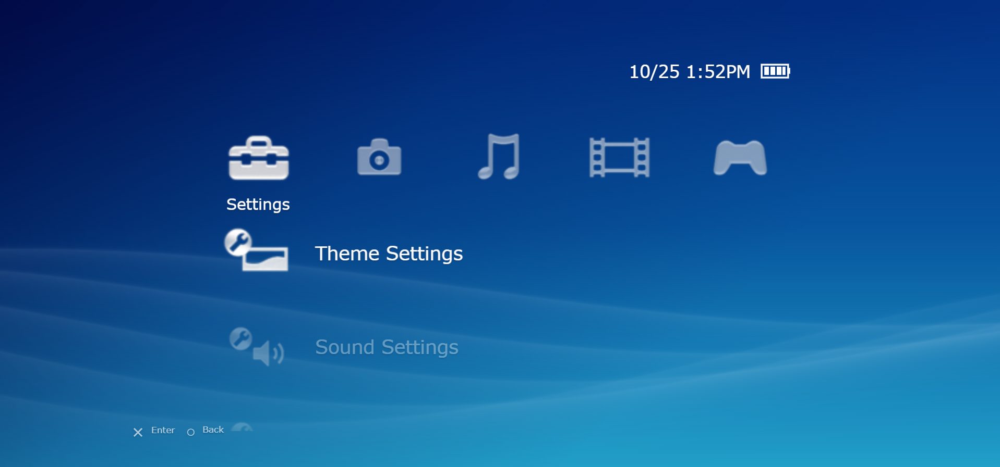

# PSP XMB

A faithful recreation of the PSP's XrossMediaBar (XMB) in a web browser. It has the original PSP style menu, moving wave background, music player, photo viewer, video playback and a few other features.

**demo:**

## Why i made this

I've always liked the PSP's menu. The moving waves, the icons, the little sounds and how everything was arranged. It was such a simple interface but it had a really nice feel to it, I always felt it was ahead of its time.

I wanted to try recreating it in a browser, not just how it looks but also making some of the original menu features actually work.

It started as a small UI recreation and I ended up making a more complete version.

## How it works

The full demo works like a PSP interface in your browser.

1. Move left and right between the original PSP-style categories and up and down through their menus.
2. Import your own music files and play them through the music player.
3. Open and view photos from your device.
4. Import and watch local video files.
5. Switch between different background themes.
6. Use the keyboard, mouse or touchscreen to navigate.
7. The background has the familiar moving PSP waves, along with a clock showing your local time.

It's all running in the browser. No actual PSP firmware or emulation involved.

## The code

I put a simplified version of the project in this public repository. It's much smaller than the full demo and mainly shows how the XMB interface works.

The simplified version includes:

- Six PSP-inspired categories with vertical menus.
- Keyboard, mouse and basic touch navigation.
- Four background themes, saved using local storage.
- Animated waves using HTML Canvas.
- A working local clock.
- A 480 × 272 interface that scales to fit different screens, with a rotation prompt on mobile portrait screens.

The menu options only open information screens. There's no actual music player, photo viewer, video playback or games in this version.

I made it using HTML, CSS and JavaScript.

To try it, just open `index.html` in your browser.

Or run it with Python:

    python -m http.server 8000

Then go to http://localhost:8000 (that's the only Python involved).

The full version has its own private repository, `psp-web`.

## me

I'm learning HTML, CSS and JavaScript. I wanted to understand how interfaces like the PSP's XMB work, so I made a smaller version of my main project that focuses on the menus, navigation, themes and animations.

It's still a learning project, and I'm figuring things out as I go.

## Still in beta

- The full demo is still being worked on, so some features might not work properly yet.
- The interface is designed around the PSP's original resolution, and scaling on some mobile screens still needs improvement.
- Touch navigation is basic for now. Landscape mode works best.
- Music and video playback depend on what file formats your browser supports.
- I still want to improve the animations and make the interface feel closer to the original PSP.

## Credit

Made by mesh3al.

The animated wave background uses work from [fchavonet's XMB Wave Background](https://github.com/fchavonet/creative_coding-xmb_wave_background). Credit to them for the original wave project.

The PSP and XrossMediaBar belong to Sony. This is a personal fan project, not affiliated with Sony.

If you try it, find bugs or have ideas, feel free to message me.

Email: syxxpath@gmail.com  
Instagram: @skrptal
