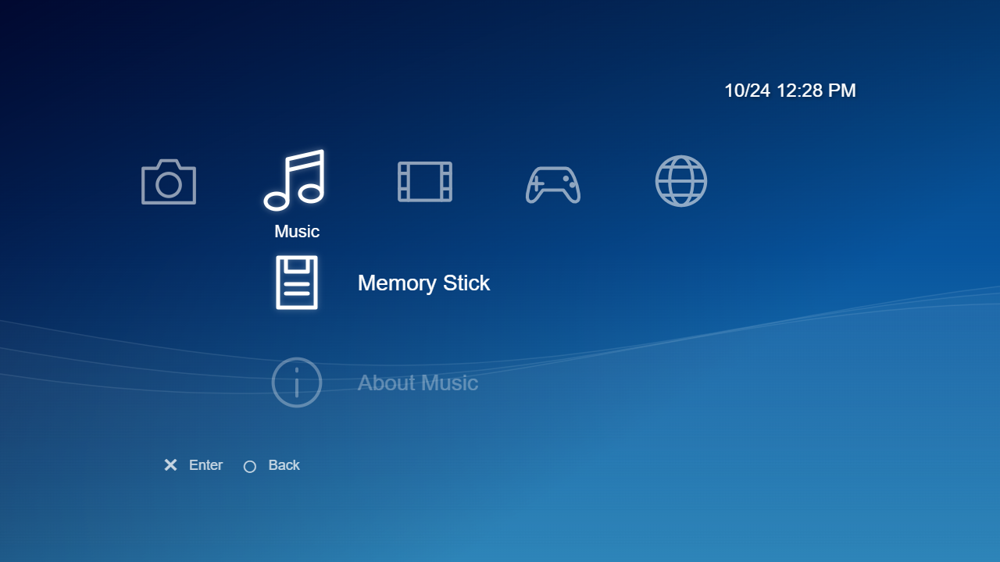

# PSP XMB — Web Recreation

A small, educational recreation of the PSP's XrossMediaBar. It explores the interface's horizontal categories, vertical menus and flowing background using HTML, CSS and vanilla JavaScript.



## Features

- Six PSP-inspired categories with selectable submenus and short information screens.
- Keyboard, mouse and basic touch navigation.
- Four background themes, with your choice saved locally when browser storage is available.
- Canvas-based animated waves, reduced-motion support and a local system clock.
- A uniformly scaled 480 × 272 interface that fits desktop and mobile landscape screens. Touch devices show a rotation prompt in portrait.

This is a standalone implementation. It does not include media importing, music or video playback, photo viewing, games or accounts. The media and system menu entries open explanatory screens rather than operating as console features.

## Technologies

HTML for the page structure, CSS for layout and transitions, and vanilla JavaScript for navigation, themes, the clock and Canvas 2D waves. No packages, external libraries, WebGL, backend or build tools are required.

## Run locally

Open `index.html` in a browser. No installation or build step is needed.

You can also serve this directory with any static file server. For example, with Python installed:

```sh
python -m http.server 8000
```

Then open [localhost:8000](http://localhost:8000).

## Controls

| Input | Action |
| --- | --- |
| Left / right arrows | Change category |
| Up / down arrows | Select a submenu item |
| Enter | Open the selected item |
| Escape or Back | Return to the XMB |
| Click / tap | Select a category or open an item |
| Swipe horizontally / vertically | Change category / submenu selection |
| Tab, then Enter or Space | Use buttons, including theme choices |

To change the theme, open **Settings → Theme Settings**.

## Full version

[Full version live demo](FULL_VERSION_LIVE_DEMO_URL) — **placeholder; the live-demo address has not been supplied.**

The full version includes local music, photos, videos and more detailed animations. Its source is maintained separately in the private `psp-web` repository. This public project contains only the simplified recreation.

## Acknowledgements

The original PSP interface and XrossMediaBar design belong to Sony. This independent educational project is not affiliated with or endorsed by Sony. Its simple SVG icons and Canvas waves are original approximations; no Sony firmware assets, fonts or recordings are included.

Development was assisted by OpenAI Codex. The source is intentionally kept small and readable for study and modification.
